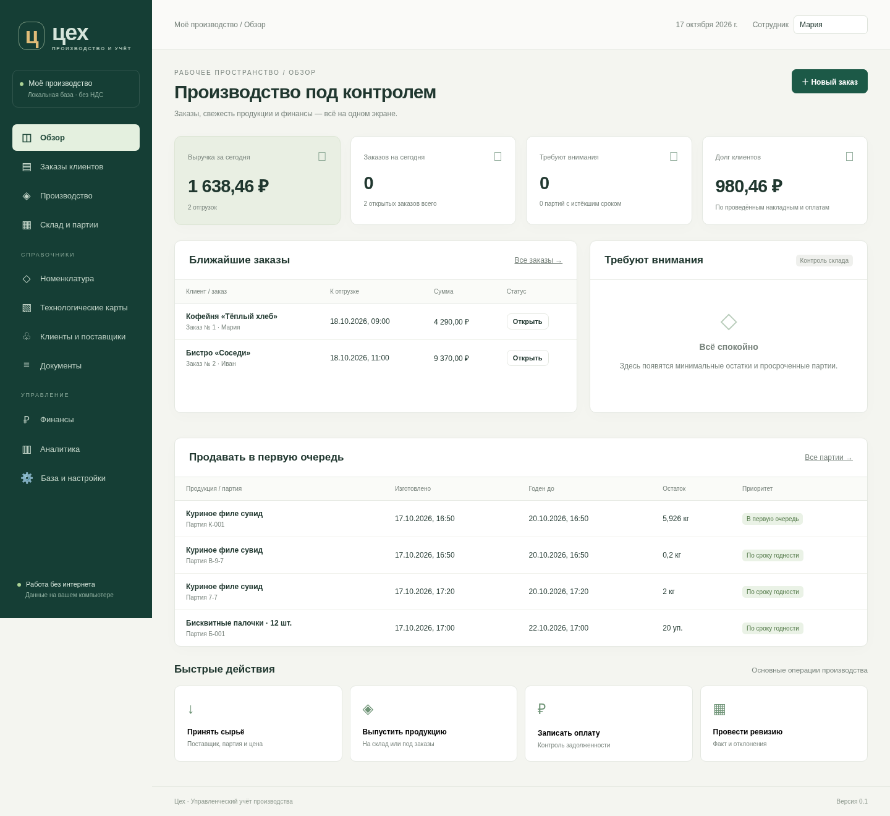

# Цех — учёт кулинарного и кондитерского производства

Рабочая первая версия локальной системы: Python 3.11+ и SQLite, без внешних библиотек для работы приложения. Интерфейс открывается в браузере. Интернет для работы не требуется. База хранится на основном компьютере, а не в браузере.



## Запуск в Windows

1. Установите **Python 3.11 или новее** с python.org с компонентом Python Launcher (`py`). Это требуется один раз. Рекомендуется Windows 10/11, актуальный Edge, Chrome или Firefox.
2. Распакуйте всю папку программы в доступный для записи каталог, например `Документы\Цех`. Не запускайте из ZIP и не помещайте рабочую базу в OneDrive или сетевую папку.
3. Дважды щёлкните **start.bat**. Откроется рабочая база. Первоначально она пустая.
4. В правом верхнем углу укажите имя сотрудника: оно подставляется в документы.
5. Окно запуска оставляйте открытым. Остановка — `Ctrl+C` в этом окне.

**Посмотреть пример:** запустите `demo.bat`. Он создаёт отдельную демонстрационную базу с сырьём, ТТК, выпуском, заказами и отгрузкой. Повторный запуск не добавляет дубликаты и не удаляет данные. Рабочая база не затрагивается.

Если Python установлен без Launcher: `python app.py --open`. Порт по умолчанию — 8765; другой порт: `python app.py --port 9000 --open`.

### Несколько сотрудников

- На основном компьютере запустите **start-network.bat**. Используется одна база и один сервер приложения.
- Определите локальный IPv4 основного компьютера командой `ipconfig`.
- На остальных рабочих местах откройте `http://АДРЕС_ОСНОВНОГО_КОМПЬЮТЕРА:8765`. Python на этих рабочих местах не нужен.
- При необходимости разрешите приложению входящие подключения в брандмауэре Windows **только в частной локальной сети**. Не открывайте порт на роутере в интернет.
- Основной компьютер должен оставаться включённым. Проводить учёт на независимых копиях базы и затем объединять их нельзя.

Роли и пароли не включены по согласованному требованию. Любой сотрудник, имеющий доступ к приложению по сети, может работать со всеми данными, включая выгрузку/восстановление. Вне доверенной сети такой режим не предназначен для использования.

### Отдельный EXE

`build-windows.bat` выполняется **на Windows** и собирает папку `dist\Ceh` с `Ceh.exe` через PyInstaller. Для сборки нужен интернет; на целевых компьютерах Python не потребуется. Переносить нужно всю папку, запускать `Ceh.exe --open`, для сети — `Ceh.exe --host 0.0.0.0 --open`. База создаётся в `data` рядом с EXE. Сборка EXE и запуск на Windows в текущей Linux-среде не проверены. В поставку входит исходный код и проверенный локальный сервер, готового Windows EXE нет.

## Первый рабочий цикл

1. **Клиенты и поставщики:** создайте поставщиков и клиентов, укажите менеджеров, сроки оплаты, дни заказа и лимиты долга.
2. **Номенклатура:** добавьте сырьё, упаковку, полуфабрикаты и готовые блюда. Задайте папки, категории, единицы, минимальные остатки, цены, сроки годности и нормы потерь.
3. **Приёмка:** выберите поставщика, добавьте партии, количества, цены за базовую единицу, даты изготовления и сроки годности.
4. **Технологические карты:** задайте базовый выход продукции и ингредиенты. Выход ингредиента — количество после потерь; брутто рассчитывается. Механические и тепловые потери применяются последовательно. При изменении создаётся новая версия ТТК.
5. **Производство → Выпуск на склад:** введите фактический выход. Заказ не нужен. Одной транзакцией спишется сырьё по ТТК и появится готовая партия. При нехватке годного сырья документ целиком отклоняется.
6. **Заказы:** выберите клиента и дату/время отгрузки. Менеджер видит годные к этой дате партии, дату изготовления первой партии и потребность других заказов. Можно заказать то, чего ещё нет: появится потребность производства.
7. **Производство:** выберите дату, получите общий наряд и потребность в сырье. Выпуск можно сделать больше клиентской потребности, на свободный склад.
8. **Открыть заказ → Отгрузить:** введите точный вес. Например, вместо планового 1 кг — 1,037 кг. Цена за единицу берётся из заказа; сумма пересчитывается. Допуск перевеса задаётся в строке заказа. Возможны частичная отгрузка и закрытие недопоставки с причиной.
9. **Финансы:** фиксируйте оплаты и расходы. Долг возникает при отгрузке, уменьшается оплатой или возвратом. Авансы сохраняются. Оплаты погашают самые ранние накладные.

### Полуфабрикаты

- **На складе:** сначала выпускается партия полуфабриката со списанием сырья. При выпуске блюда расходуется полуфабрикат; исходное сырьё повторно не списывается.
- **Разложить на сырьё:** полуфабрикат — вложенная рецептура, при выпуске блюда рекурсивно рассчитывается сырьё. Отдельной партии такого полуфабриката нет.
- Циклические рецептуры запрещены. Рецептуры сохраняются версиями; выпуски хранят снимок состава и фактически списанные партии.

### Свежесть, списание и ревизия

На обзоре есть список **«Продавать в первую очередь»**, на складе — даты изготовления и сроки всех партий. Партии подбираются по FEFO: ближайший срок годности первым. Просроченная и карантинная продукция не расходуется. Автоматического физического списания просрочки нет: сотрудник оформляет списание с причиной и ответственным.

Ревизия показывает учёт, факт и отклонение каждой партии. При отклонении обязательна причина. Если остаток изменился во время подсчёта, документ отклоняется: обновите ведомость. Ведомость для печати/Excel доступна в разделе склада. Неучтённые новые партии оформляются поступлением либо выпуском; затем можно скорректировать их факт ревизией.

### Ошибки и возвраты

В журнале откройте документ → **Отменить документ**. Исходная запись сохраняется, создаются обратные движения с причиной и ответственным. Зависимые документы отменяются в обратном порядке. После отмены отгрузки заказ открывается снова. Удаления проведённых документов нет.

В накладной доступен **Возврат клиента**. Количество не может превышать ещё не возвращённое. Создаётся карантинная партия с исходными сроками и себестоимостью; долг клиента уменьшается. На складе её можно списать либо допустить к продаже отдельным решением с основанием. Просроченную партию допустить нельзя. Возврат денег клиенту отдельной кассовой операцией пока не реализован; возврат создаёт уменьшение долга или аванс.

### Единицы и калькуляция

- Учёт в кг, л, шт. или уп. Граммы и миллилитры при вводе автоматически переводятся в кг и л.
- Количество штук и упаковок — целое. Произвольного перевода литров в кг нет. Состав упаковки в карточке справочный, не создаёт отдельный складской остаток внутренних штук.
- В рецептуре упаковка может быть отдельным ингредиентом и входит в стоимость выпуска. Дробная потребность штучных ингредиентов округляется вверх на партию выпуска.
- Калькуляция — по последнему поступлению по дате документа; начальная цена в карточке используется до первой закупки. Фактическая себестоимость выпуска и отгрузки — по использованным партиям.
- Цена продажи задаётся в карточке и копируется в заказ. Заказы сохраняют собственную цену, последующее изменение карточки её не меняет. Индивидуальные прайс-листы пока заменяются ручной ценой строки заказа.

## Аналитика и выгрузки

Период, группировка по продукции/клиентам/дням, выбор колонок сохраняются в текущем браузере. Отчёт показывает количества отдельно по единицам, выручку, стоимость партий и валовую прибыль, учитывает возвраты и отмены. Есть история закупочных цен и задолженность по накладным. Результат периода вычитает расходы и списания; это управленческий показатель, не бухгалтерская прибыль. Ревизионные корректировки в этот показатель не включены, доступны в документах.

Документы, заказы, ТТК, калькуляции, наряд, складская ведомость и отчёты выгружаются в **XLSX, DOCX, CSV, JSON**. **Печать / PDF** открывает печатную форму: в диалоге печати браузера выберите «Сохранить как PDF». Это пользовательские управленческие формы, не утверждённые унифицированные бланки. Обмен с **1С отложен**.

Напоминания в обзоре: просроченные долги, просроченные партии, минимальные остатки, звонки клиентам по дням заказа. Для дней используйте `Пн, Вт, Ср, Чт, Пт, Сб, Вс` или `Ежедневно`. Напоминания доступны при открытом приложении; системных уведомлений при закрытом сервере нет.

## База и резервное копирование

- Рабочая база: `data/ceh.sqlite3`. Демо: `data/demo/ceh.sqlite3`.
- **База и настройки → Скачать резервную копию** создаёт согласованную SQLite-копию даже при открытом приложении. Её можно перенести на другой компьютер и восстановить.
- Автоматическая копия создаётся при первом запуске за день в `data/backups`; это не ежесуточное расписание при непрерывной работе сервера. Ручные копии также сохраняются туда. Автоматической очистки старых копий нет.
- Восстановление проверяет файл, целостность и связи. До замены сохраняется текущая база. Попросите сотрудников завершить работу, загрузите копию до 48 МБ, введите `ВОССТАНОВИТЬ`.
- Для большой копии: остановите сервер, сохраните всю текущую папку `data` в отдельное место, замените её новой папкой с файлом `ceh.sqlite3` из проверенной резервной копии. Не переносите старые файлы `-wal`/`-shm` в новую папку.
- Не копируйте один файл активной рабочей базы вручную: при WAL часть данных может находиться в сопутствующем файле. Используйте кнопку выгрузки.
- Для обновления заменяются файлы программы, папка `data` сохраняется. Версия схемы хранится в базе; неизвестная версия отклоняется, данные автоматически не пересоздаются. Будущие версии должны включать миграции; расширение аналитики не требует удаления документов.

## Границы версии 0.1

Реализован сквозной рабочий цикл, но это первая версия для проверки на ваших реальных рецептурах и документах. Пока: один склад, без выделенного справочника сотрудников/ролей, без отдельного расписания оборудования и смен, печати этикеток, индивидуальных прайс-листов, объединения нескольких заказов в одну накладную и автоматического хранения производственных заданий. Наряд рассчитывается из открытых заказов; выпуск фиксируется отдельным документом. Партии не закрепляются за заказом: система показывает потребность и свободный остаток с учётом более ранних заказов, окончательная проверка происходит при отгрузке. Жёстких резервов и автоматической отмены производственного плана нет. Папки задаются путём `Кулинария / Мясо` и фильтруются, без отдельного дерева с drag-and-drop. Нормативный и фактический выход есть в ТТК и выпуске; отдельный документ анализа производственного брака пока не предусмотрен, брак оформляется списанием.

## Проверки разработки

```sh
python -m unittest discover -s tests -v
python -m py_compile app.py domain.py exports.py demo.py
node --check static/app.js
```

27 автоматических проверок: списания по ТТК, последовательные потери, полуфабрикаты, циклы, атомарность, FEFO, просрочка, фактический вес, частичные отгрузки, лимиты, оплаты, ревизии, конкуренция, отмены, возвраты, карантин, резервные копии и форматы выгрузки.

Опциональная браузерная проверка (Playwright нужен только разработчику):

```sh
CHROMIUM_PATH=/usr/bin/chromium python tests/browser_smoke.py
```

Проверяет навигацию, формы, выпуск, заказ, фактический вес, печать, XLSX и мобильный размер экрана. Автотесты используют временные базы, рабочие данные не затрагиваются. Проверки выполнены в Linux; Windows-сборка и совместная работа в вашей локальной сети требуют проверки на целевых компьютерах.
